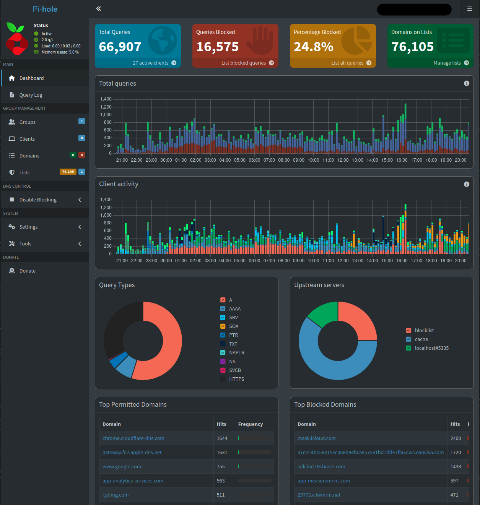

# Raspberry Pi DNS-Server

## Project Overview

For this project, I built a self-hosted DNS server using a Raspberry Pi 4. The goal was to have more control over how DNS queries are handled across my home network, including content filtering and network-wide ad blocking. This also gives me better visibility into the traffic and devices on my network, while improving overall privacy and security.

Using a combination of lightweight, free, and open-source services like Pi-hole and Unbound makes this setup both affordable and relatively straightforward to implement.

Throughout this project, I've been able to expand my knowledge of networking, Linux administration, and working within the terminal. It's also given me some hands-on experience with managing a server and configuring multiple services to work together. This is something I can continue building on as I get more involved with networking and self-hosting.

## Objectives

The goal of this project is to move away from relying on third-party upstream DNS providers and instead build my own self-hosted recursive DNS solution. This gives me greater control over DNS resolution, improves network-wide privacy, and provides better visibility and management of DNS traffic.

Some of the main objectives include:

Self-Hosted DNS: Build and manage my own recursive DNS infrastructure using Pi-hole and Unbound.
Privacy: Reduce reliance on third-party DNS providers and limit the amount of DNS query data shared externally.
Ad Blocking: Implement network-wide ad and content filtering.
Network-Wide Configuration: Configure DNS at the router level so all connected clients automatically use my DNS server.
Learning: Gain hands-on experience with DNS, networking, Linux administration, and server management.

## Hardware and Software

### Hardware

- Raspberry Pi 4 (4GB RAM)
- microSD Card (64GB)
- Eero Gateway 6+
- Hardware Ethernet connection

### Software

- Ubuntu Server - (Operating System)
- Pi-hole - DNS (Sinkhole) - DNS filtering & Ad Blocking
- Unbound - (Recursive DNS) -  Resolver and DNSSEC Validation
- OpenSSH - (SSH Service) - Secure Remote Administration

## Network Architecture

### Current Network Setup

Eero Gateway: Handles network routing and DHCP services, assigning IP addresses to connected devices. It receives incoming internet traffic and directs DNS queries to the Raspberry Pi for DNS resolution and filtering.

Raspberry Pi 4: Runs Pi-hole and Unbound on Ubuntu Server, providing DNS filtering, domain validation, and recursive DNS resolution. It is assigned a static IP address through the Eero gateway to ensure clients have a consistent DNS server address.

Client Devices: Receive their IP configuration and DNS server information from the Eero gateway through DHCP. DNS queries are forwarded to the Raspberry Pi, where Pi-hole filters unwanted domains and Unbound handles DNS resolution before returning the results to clients.

### DNS Query Flow

1. Client Device:
	- Requests the IP address for a domain 
2. Pi-hole:Port 53
	- Checks blokcing rules and cache
3. Unbound:Port 5335
	- Resolves permitted queries when needed
4. DNS Hierarchy:
	- Root->TLD->Authoritative DNS servers
5. Return:
	- The DNS answer returns through unbound and Pi-hole to the client

### Pi-Hole and Unbound Communication

Pi-hole (Port 53):
	- Acts as the primary DNS service for clients on local network. Receives DNS queries, checks them against block-lists and returns cached responses when available.
Unbound (Port 5335):
	- Acts as the upstream Recursive DNS resolver, Pi-hole forwards valid DNS queries hat require upstream resolution
Port Separation:
	- Pi-hole and Unbound use different ports to avoid conflicts due to both services running on the same Raspberry pi.
Loopback Address(127.0.0.1):
	- Allows Pi-hole to communicate directly with Unbound on the same device without sending those requests across the local network.
DNS Forwarding:
	- Pi-hole is configured to use 127.0.0.1#5335 as its upstream destination.
## Security

- **SSH Authentication:**
	- During the initial setup of the Raspberry Pi, you can configure how you authenticate when establishing an SSH session. I configured Ed25519 public-key authentication to provide secure remote administration.

This process generates a private and public key pair. The private key is stored locally on the host machine and protected with a passphrase, while the public key is copied to the Raspberry Pi. During authentication, the Pi verifies a cryptographic signature generated by the private key.

This approach eliminates the need to transmit the account password during SSH authentication and provides a more secure alternative to password-based login.
- ** Private Key Protection:**
	- Private Key Protection

The private key is never shared or transmitted during an SSH session. Instead, it remains securely stored on the host machine and is protected by a passphrase. Once the correct passphrase is entered, the private key can be used to generate a cryptographic signature in response to the server's authentication challenge.

The Raspberry Pi then verifies this signature against the corresponding public key stored on the server. This process allows the server to authenticate the user without ever requiring the private key to leave the host machine or transmitting the account password over the network.
- **DNSSEC Validation:**
	- Configured through the Unbound service, DNSSEC (Domain Name System Security Extensions) is a security measure used to verify the authenticity and integrity of DNS responses. It uses cryptographic signatures to ensure that the DNS records being returned have not been altered or tampered with. This helps protect against DNS spoofing and forged DNS responses.
- **QNAME Minimization:**
	- Configured through the Unbound service, QNAME minimization is a privacy measure that limits how much information is shared with external DNS servers during the resolution process. Instead of sending the full requested domain name to every DNS server involved, Unbound breaks the query down and only sends the information needed at each stage. This helps reduce the amount of browsing information exposed to external DNS servers while maintaining recursive DNS resolution.
- ** Local DNS Communication:**
	- Unbound listens on 127.0.0.1#5335 to avoid conflicting with Pi-hole, which handles DNS requests on port 53. Since Unbound uses a loopback address, it isn't directly accessible to other devices on the LAN and only communicates locally with Pi-hole. Unbound also caches DNS responses, similar to Pi-hole, which helps speed up future queries by returning previously resolved results without having to perform another recursive lookup.

## Testing and Validation

- **DNS Resolution:**

(cmd) - dig @127.0.0.1 google.com A: - Verifies that Pi-hole can resolve an allowed domain

	- Expected: ; <<>> DiG 9.18.39-0ubuntu0.24.04.9-Ubuntu <<>> @127.0.0.1 google.com A
; (1 server found)
;; global options: +cmd
;; Got answer:
;; ->>HEADER<<- opcode: QUERY, status: NOERROR, id: 55181
;; flags: qr rd ra; QUERY: 1, ANSWER: 6, AUTHORITY: 0, ADDITIONAL: 1

;; OPT PSEUDOSECTION:
; EDNS: version: 0, flags:; udp: 1232
;; QUESTION SECTION:
;google.com.			IN	A

;; ANSWER SECTION:
google.com.		300	IN	A	172.253.124.102
google.com.		300	IN	A	172.253.124.113
google.com.		300	IN	A	172.253.124.101
google.com.		300	IN	A	172.253.124.100
google.com.		300	IN	A	172.253.124.139
google.com.		300	IN	A	172.253.124.138

- **DNSSEC Validation:**

(cmd) -  dig @127.0.0.1 -p 5335 dnssec-failed.org A: - Verifies that DNSSEC is working as it should. This domain has an intentionally broken DNSSEC signature. 
	
	- Expected: ; <<>> DiG 9.18.39-0ubuntu0.24.04.9-Ubuntu <<>> @127.0.0.1 -p 5335 dnssec-failed.org A
; (1 server found)
;; global options: +cmd
;; Got answer:
;; ->>HEADER<<- opcode: QUERY, status: SERVFAIL, id: 45649
;; flags: qr rd ra; QUERY: 1, ANSWER: 0, AUTHORITY: 0, ADDITIONAL: 1

;; OPT PSEUDOSECTION:
; EDNS: version: 0, flags:; udp: 1232
;; QUESTION SECTION:
;dnssec-failed.org.		IN	A

;; Query time: 507 msec
;; SERVER: 127.0.0.1#5335(127.0.0.1) (UDP)
;; WHEN: Sun Nov 22 18:37:14 EST 2026
;; MSG SIZE  rcvd: 46
- **Service Availability:**

(cmd) pihole status - Verifies Pi-hole is active and operational 
	- Expected: Warning: /etc/pihole/pihole.toml exists but cannot be read (Permission denied).
         The value shown below may not reflect the current configuration.
         Try running this command with sudo.
  [✓] FTL is listening on port 53
     [✓] UDP (IPv4)
     [✓] TCP (IPv4)
     [✓] UDP (IPv6)
     [✓] TCP (IPv6)

Warning: /etc/pihole/pihole.toml exists but cannot be read (Permission denied).
         The value shown below may not reflect the current configuration.
         Try running this command with sudo.
  [✓] Pi-hole blocking is enabled

(cmd) systemctl is-active unbound - Verifies that Unbound is active and operational.
	- Expected: active 

- **SSH Authentication:**

(cmd) -  sudo sshd -T | grep -E '^(pubkeyauthentication|passwordauthentication|permitrootlogin|kbdinteractiveauthentication)' - Verifies that public-key auth is enabled, password based is disabled, and that login as root is disabled.

Expected:
	- permitrootlogin no
	- pubkeyauthentication yes
	- passwordauthentication no
	- kbdinteractiveauthentication no
 
## Troubleshooting & Lessons Learned

### Pi-hole DNS Resolution Failure

**What Happened?:**

Queries returned refused because an upstream resolver wasnt configured initially meaning it could not resolve any queries submitted locally to Pi-hole.

**What Resolved It?:**

Temporarily set cloudflare as the upstream DNS provider within the admin console of Pi-hole after doing so I tested with another query and pi-hole was able to successfully resolve the query using the third-party resolver.

### Unbound DNSSEC Validation Failure

**What Happened?:**

Valid Domains returned SERVFAIL during DNSSEC Validation.

**What Resolved it?:**

Refreshed the DNSSEC root trust anchor.

The root trust anchor is the starting point Unbound uses to begin verifying DNSSEC signatures. Without this Unbound cannot establish trust with the queries clients are requesting, this does not explicitly mean that the queries are invalid or unavailable. 

(cmd) sudo unbound-anchor -a /var/lib/unbound/root.key -v - Checks and updates Unbounds root trust anchor when necessary.
(cmd) sudo systemctl restart unbound - Restart unbound service after making changes.
(cmd) dig @127.0.0.1 -p 5335 example.com - Great cmd to run to verify that DNSSEC is working
	- dig @127.0.0.1 -p 5335 dnssec-failed.org

### SSH Authentication Issues

**What Happened?:** 

Public-key login and key passphrase issues during setup.

**What Resolved it?:**

Generated a replacment key pair and installed the public key on the raspberry pi, before doing so I removed the previous keys that I was having issues with. Make sure you make a note of what the public key file is called.

(cmd) ssh-keygen -t ed25519 -f ~/.ssh/pi-dns-01 - Key par generation for SSH Auth
(cmd) ssh -1 ~/.ssh/pi-dns-01 user@IP - Initiates SSH session with pubkey authentication.

## Screenshots

### Pi-hole Dashboard

## References

- [Pi-hole Documentation](https://docs.pi-hole.net)
- [Pi-hole and Unbound Documentation](https://docs.pi-hole.net/guides/dns/unbound/)
- [Ubuntu OpenSSH Documentation](https://ubuntu.com/server/docs/how-to/security/openssh-server/)
- [Unbound documentation](https://nlnetlabs.nl/projects/unbound/about/)
